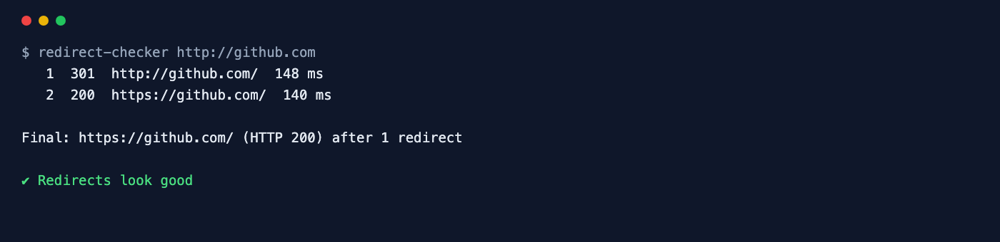

<div align="center">

# Redirect Checker

**Trace every hop of a redirect chain — status codes, loops and the final URL.**

[](https://github.com/ksanyok/redirect-checker/actions/workflows/ci.yml) [](LICENSE)   [](https://promopilot.link/en/tools/redirect-checker.php?utm_source=github&utm_medium=repo&utm_campaign=tools&utm_content=redirect-checker)

**[▶ Use the free online version — no install, no sign-up](https://promopilot.link/en/tools/redirect-checker.php?utm_source=github&utm_medium=repo&utm_campaign=tools&utm_content=redirect-checker)**

</div>

`redirect-checker` requests a URL without following redirects automatically, so it can show you every hop: the status code (301, 302, 303, 307, 308 or a `<meta>` refresh), where it points, how long it took — and where the chain finally lands. It flags the problems that waste crawl budget and link equity: chains of three or more hops, loops, HTTPS-to-HTTP downgrades, temporary redirects used for permanent moves and chains that end in a 404 or 500.



## What it checks

- Every hop with its status code, resolved `Location`, response time and server
- 301 and 308 (permanent) vs. 302, 303 and 307 (temporary) — and temporary redirects used for HTTP → HTTPS
- `<meta http-equiv="refresh">` redirects, followed like a browser would
- Redirect loops and chains that never end (configurable hop limit)
- Chains of three or more redirects that waste crawl budget and slow users down
- HTTPS → HTTP downgrades and final pages served over plain HTTP
- Chains that end in a 4xx or 5xx error, and hosts that do not resolve

## Why it matters

Redirects pile up over years of migrations: `http` to `https`, `www` to bare domain, old slugs to new ones, a trailing-slash rule on top. Each layer adds a hop, and every hop costs a round trip for visitors and a bit of trust for search engines — after a few hops crawlers may stop following, and a temporary 302 where a 301 belongs can keep the old URL in the index. Loops and chains that end in a 404 lose the traffic completely. Seeing the whole chain is the first step to collapsing it into a single 301.

## Quick start

```bash
# run straight from GitHub, nothing to install
npx github:ksanyok/redirect-checker example.com

# or install the CLI globally
npm install -g github:ksanyok/redirect-checker
redirect-checker example.com
```

Check several URLs at once:

```bash
redirect-checker http://example.com https://www.example.com/old-page
```

Check a whole migration map:

```bash
redirect-checker --file old-urls.txt --json > report.json
```

See what Googlebot gets:

```bash
redirect-checker example.com --ua "Mozilla/5.0 (compatible; Googlebot/2.1; +http://www.google.com/bot.html)"
```

## Example output

```text
$ redirect-checker http://github.com
   1  301  http://github.com/  191 ms
   2  200  https://github.com/  178 ms

Final: https://github.com/ (HTTP 200) after 1 redirect

✔ Redirects look good
```

## CLI

```text
Usage: redirect-checker <url> [url ...] [options]
       redirect-checker --file urls.txt

Follows a URL hop by hop (301, 302, 307, 308 and <meta> refresh) and shows the
full chain with status codes, timings, loops, downgrades and the final page.

Options:
  --ua <agent>      User agent to send (e.g. "Googlebot")
  --max <n>         Maximum number of hops (default: 10)
  --head            Use HEAD requests instead of GET
  --file <path>     Check every URL in a file (one per line)
  --json            Print JSON
  --strict          Exit with code 1 on warnings too
  -h, --help        Show this help

Online version (no install): https://promopilot.link/en/tools/redirect-checker.php
```

## Use as a library

```js
import { traceRedirects } from '@promopilot/redirect-checker';

const report = await traceRedirects('http://example.com/old', { maxHops: 10 });
for (const hop of report.hops) console.log(hop.status, hop.url, '→', hop.location);
console.log(report.final, report.finalStatus, report.redirects, report.issues);
```

`traceRedirects(url, { maxHops, userAgent, method, fetch, followMeta })` returns `{ start, final, finalStatus, redirects, hops[], issues[], ok }`; each hop has `url`, `status`, `location`, `kind` (`permanent`, `temporary`, `meta-refresh`), `ms` and `server`. Issue codes are stable: `loop`, `too-many`, `long-chain`, `temporary-https`, `temporary`, `https-downgrade`, `meta-refresh`, `final-error`, `no-https`, `fetch-failed`.

## Use in CI (GitHub Actions)

Verify after a deploy that legacy URLs still land on live pages in one hop:

```yaml
on: [deployment_status]
jobs:
  redirects:
    runs-on: ubuntu-latest
    steps:
      - uses: actions/checkout@v4
      - uses: ksanyok/redirect-checker@v1
        with:
          args: --file test/legacy-urls.txt --strict
```

## How it works

Each request is made with Node's built-in `fetch` and `redirect: 'manual'`, so the redirect response itself is visible: its status and `Location` header (resolved against the current URL, so relative locations work). The next hop is requested until a non-redirect response, a repeated URL (loop) or the hop limit. For HTML pages with status 200 the body is scanned for a `<meta http-equiv="refresh">` target. Bare domains start at `http://`, exactly like a user typing the address.

## CLI vs. online version

| | This package | [Online tool](https://promopilot.link/en/tools/redirect-checker.php?utm_source=github&utm_medium=repo&utm_campaign=tools&utm_content=redirect-checker) |
|---|---|---|
| Runs on | Your machine, CI, deploy hooks | Any browser |
| Bulk checks | Yes, `--file` with hundreds of URLs | One URL at a time |
| Custom user agent | Any, with `--ua` | Preset agents |
| Output | Text, JSON, exit codes | Visual chain with explanations |
| Price | Free, MIT | Free, no sign-up |


## FAQ

<details>
<summary><b>301 or 302 — does it matter for SEO?</b></summary>

Google treats long-standing 302s much like 301s eventually, but a 301 (or 308) states the move is permanent and consolidates signals faster. Use 302/307 only for genuinely temporary moves.
</details>

<details>
<summary><b>How many redirects are too many?</b></summary>

One is ideal. Google follows up to 10 hops but recommends fewer than 3-5; every hop adds latency for users. Link directly to the final URL and collapse chains on the server.
</details>

<details>
<summary><b>What is the difference between 307 and 308?</b></summary>

They are the method-preserving versions of 302 and 301: a POST stays a POST. For normal page moves 301/308 are equivalent for SEO.
</details>

<details>
<summary><b>Are meta refresh redirects bad?</b></summary>

Google follows instant meta refreshes, but they are slower, not understood by every client and look like a soft 404 when delayed. Prefer a server-side 301.
</details>

<details>
<summary><b>Why does the tool show a different result than my browser?</b></summary>

Browsers cache 301 redirects and may have HSTS rules that upgrade to HTTPS before any request. The tool always makes fresh requests.
</details>

<details>
<summary><b>Is there a version without installing anything?</b></summary>

Yes — the [online Redirect Checker](https://promopilot.link/en/tools/redirect-checker.php?utm_source=github&utm_medium=repo&utm_campaign=tools&utm_content=redirect-checker) runs the same checks in the browser and explains each result.
</details>

## Related free tools

- [Robots.txt Checker](https://promopilot.link/en/tools/robots-checker.php?utm_source=github&utm_medium=repo&utm_campaign=tools&utm_content=robots-checker) — test robots.txt rules against any URL
- [Sitemap Analyzer](https://promopilot.link/en/tools/sitemap-analyzer.php?utm_source=github&utm_medium=repo&utm_campaign=tools&utm_content=sitemap-analyzer) — validate XML sitemaps and sitemap indexes
- [SSL Checker](https://promopilot.link/en/tools/ssl-checker.php?utm_source=github&utm_medium=repo&utm_campaign=tools&utm_content=ssl-checker) — certificate chain, expiry, TLS versions
- [Security Headers Checker](https://promopilot.link/en/tools/security-headers.php?utm_source=github&utm_medium=repo&utm_campaign=tools&utm_content=security-headers) — CSP, HSTS and other HTTP security headers
- [Website Status](https://promopilot.link/en/tools/website-status.php?utm_source=github&utm_medium=repo&utm_campaign=tools&utm_content=website-status) — is a site down for everyone or just you
- [All 120+ free SEO, email and web tools](https://promopilot.link/en/tools/?utm_source=github&utm_medium=repo&utm_campaign=tools&utm_content=redirect-checker)

## Contributing

Bug reports and pull requests are welcome — see [CONTRIBUTING.md](CONTRIBUTING.md). Security issues: [SECURITY.md](SECURITY.md).
More docs live in the [wiki](https://github.com/ksanyok/redirect-checker/wiki) (sources in [docs/wiki](docs/wiki)).

## License

[MIT](LICENSE) © 2026 Alexandr Krikun

---

<sub>Built and maintained by the team behind [PromoPilot](https://promopilot.link/?utm_source=github&utm_medium=repo&utm_campaign=tools&utm_content=redirect-checker) — link building, SEO monitoring and 120+ free tools for site owners. Also on [YouTube](https://www.youtube.com/channel/UCPB8m7BgaexcZh0Vr49ViYA).</sub>
